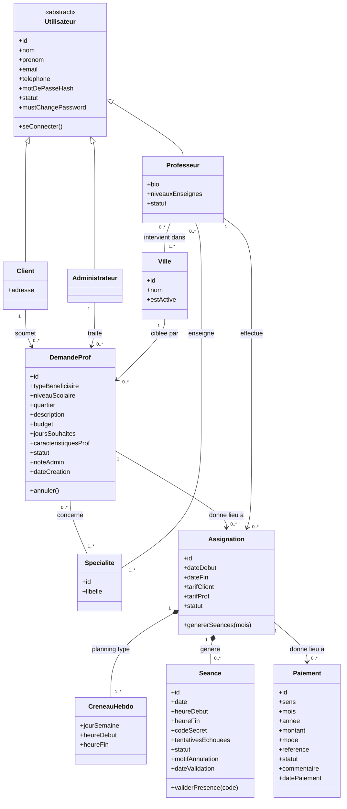
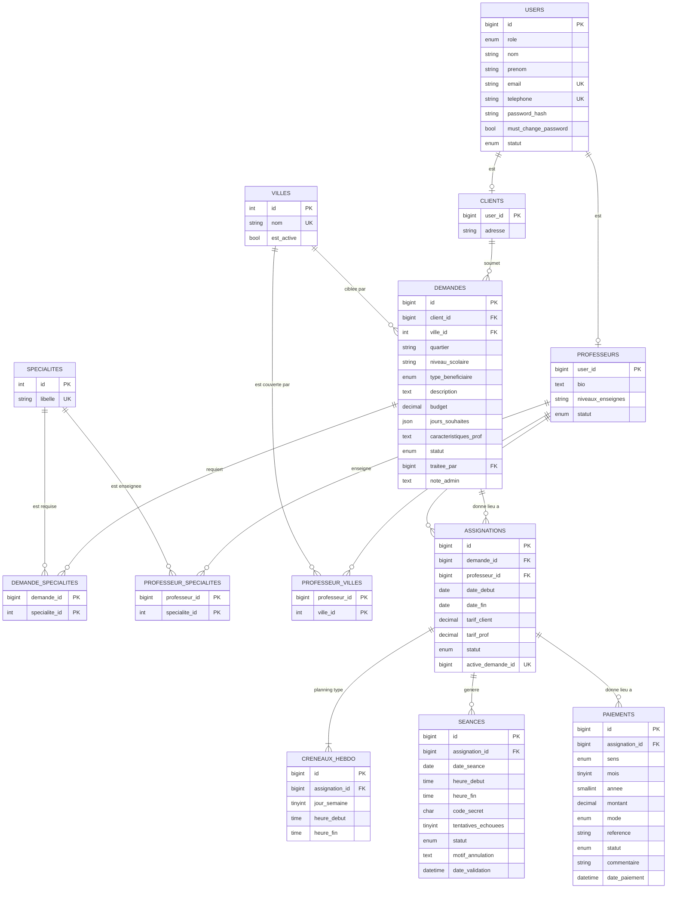

# AlloProf - Modélisation

Deux vues du même modèle : le diagramme de classes (le métier) et le schéma relationnel MySQL (la base de données).

## 1. Diagramme de classes

## 2. Schéma de base de données (MySQL)

## 3. Règles de gestion & Conception technique

1. **Utilisateurs & Profils (`users`, `clients`, `professeurs`)** :
   - Table `users` centrale avec héritage Table-Per-Type.
   - Le champ `telephone` est obligatoire (`NOT NULL`) et unique (`uq_users_telephone`), fondamental pour l'authentification OTP et les flux Mobile Money.

2. **Couverture géographique & Spécialités** :
   - Un professeur est associé à une ou plusieurs villes d'intervention (`professeur_villes`) et à ses spécialités de cours (`professeur_specialites`).
   - Une demande cible une ville (`ville_id`) et précise le `quartier` d'intervention ainsi que le `niveau_scolaire` recherché.
   - Une demande peut porter sur une ou plusieurs spécialités via la table de liaison `demande_specialites` (ex: *Mathématiques* et *Physique-Chimie* dans la même mission).

3. **Assignation & Planning** :
   - Le pivot `assignations` relie une demande à un professeur avec les tarifs convenus.
   - La colonne virtuelle générée `active_demande_id` indexée de manière unique garantit qu'une demande n'a qu'**une seule assignation active** à la fois dans le SGBD.
   - Les `creneaux_hebdo` définissent le modèle hebdomadaire récurrent.
   - Les `seances` représentent les dates réelles générées pour le mois avec code secret d'émargement (anti-fraude) et traçabilité du statut (`PREVUE`, `EFFECTUEE`, `MANQUEE`, `ANNULEE`).

4. **Paiements échelonnés** :
   - Les flux `sens` séparent `CLIENT_VERS_ADMIN` et `ADMIN_VERS_PROF`.
   - L'indexation non-unique sur la période permet les règlements en plusieurs tranches (ex: acompte 50% au lancement, solde en milieu de mois).

Le script SQL complet prêt à être exécuté est dans [alloprof_schema.sql](file:///home/nathan-voglossou/AlloProf-Backend/alloprof_schema.sql).
