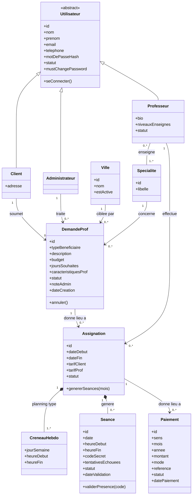
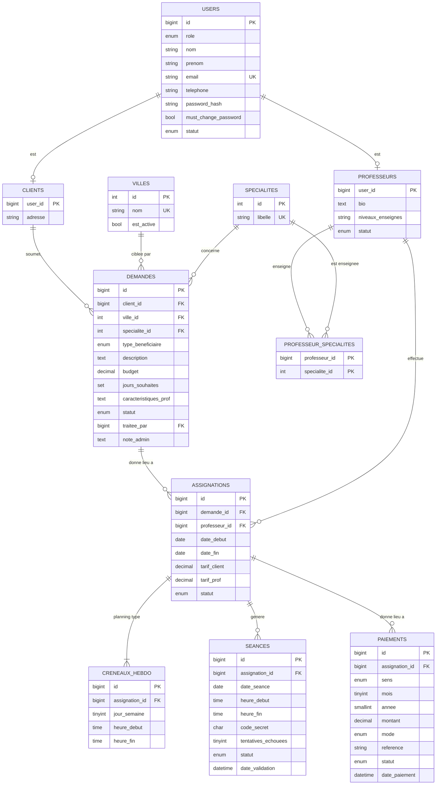

# AlloProf - Modélisation

Deux vues du même modèle : le diagramme de classes (le métier) et le schéma relationnel MySQL (la base de données).

## 1. Diagramme de classes

## 2. Schéma de base de données (MySQL)

Le script SQL complet est dans alloprof_schema.sql.
