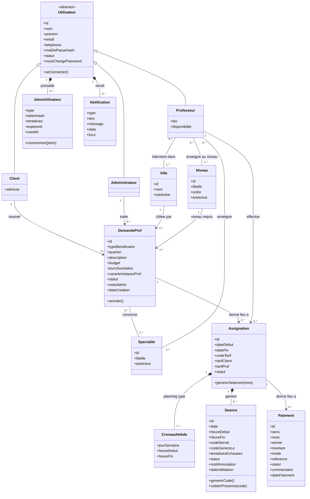
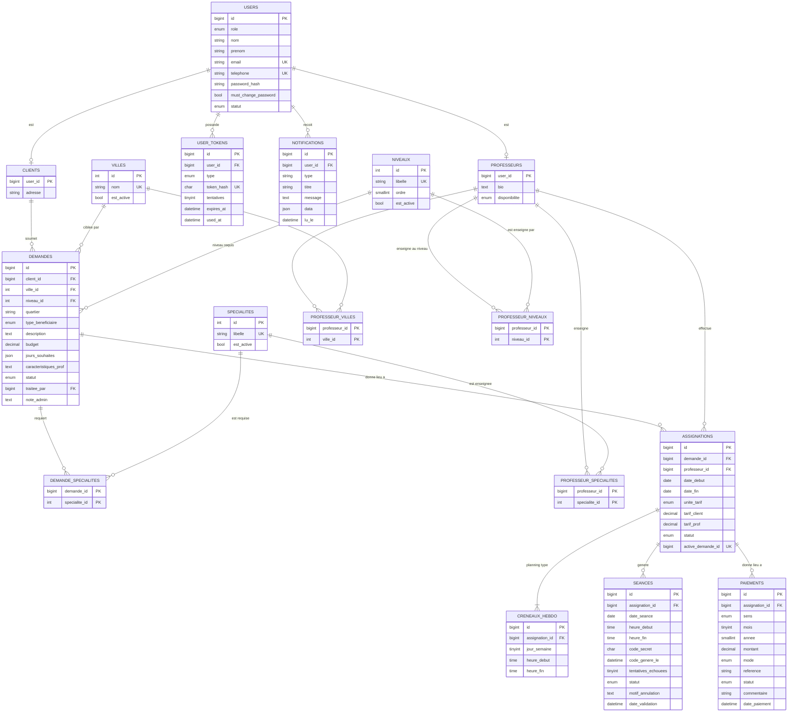

# AlloProf - Modélisation

Deux vues du même modèle : le diagramme de classes (le métier) et le schéma relationnel MySQL (la base de données).

> Source de vérité : [alloprof_diagramme_classes.mmd](alloprof_diagramme_classes.mmd), [alloprof_schema_erd.mmd](alloprof_schema_erd.mmd) et [alloprof_schema.sql](alloprof_schema.sql). Les diagrammes ci-dessous en sont des copies : modifier d'abord les `.mmd`.

## 1. Diagramme de classes

## 2. Schéma de base de données (MySQL)

## 3. Règles de gestion & Conception technique

1. **Utilisateurs & Profils (`users`, `clients`, `professeurs`)** :
   - Table `users` centrale avec héritage Table-Per-Type. La cohérence entre `users.role` et la table de profil (un `CLIENT` n'a pas de ligne dans `professeurs`) est garantie par l'application.
   - Le champ `telephone` est obligatoire (`NOT NULL`) et unique (`uq_users_telephone`), fondamental pour l'authentification OTP et les flux Mobile Money.
   - `users.statut` (`ACTIF` / `SUSPENDU`) contrôle la **connexion**. `professeurs.disponibilite` (`DISPONIBLE` / `INDISPONIBLE`) indique seulement si le prof accepte de **nouvelles** assignations.

2. **Invitation des profs & jetons (`user_tokens`)** :
   - L'admin crée le prof sans mot de passe (`password_hash` NULL). Un jeton `INVITATION` est généré et envoyé par email/SMS sous forme de lien ; le prof définit lui-même son mot de passe. Aucun mot de passe ne circule en clair.
   - La même table gère `RESET_PASSWORD` et `OTP`. Seule l'empreinte SHA-256 du jeton est stockée (`token_hash`). Un jeton est à usage unique (`used_at`), expire (`expires_at`), et un OTP est invalidé après 5 `tentatives` ratées.

3. **Référentiels (`villes`, `specialites`, `niveaux`)** :
   - Un référentiel utilisé ne se supprime pas (`ON DELETE RESTRICT`) : on le désactive via `est_active`. L'historique des demandes reste intact.
   - `niveaux.ordre` permet de comparer les niveaux (ex : un prof qui enseigne jusqu'en Terminale couvre la 3e).

4. **Couverture géographique, spécialités & niveaux** :
   - Un professeur est associé à ses villes d'intervention (`professeur_villes`), ses spécialités (`professeur_specialites`) et ses niveaux (`professeur_niveaux`).
   - Une demande cible une ville (`ville_id`), un niveau (`niveau_id`) et précise le `quartier`.
   - Une demande peut porter sur une ou plusieurs spécialités via `demande_specialites` (ex : *Mathématiques* et *Physique-Chimie* dans la même mission).
   - Le matching demande ↔ prof se fait donc par requête : même ville, spécialités couvertes, niveau couvert, prof `DISPONIBLE`.

5. **Assignation & Planning** :
   - Le pivot `assignations` relie une demande à un professeur avec les tarifs convenus. `unite_tarif` (`SEANCE`, `HEURE`, `MOIS`) précise ce que couvrent `tarif_client` et `tarif_prof`, et donc comment calculer les montants du mois :
     - `SEANCE` : tarif × nombre de séances `EFFECTUEE` du mois ;
     - `HEURE` : tarif × somme des durées des séances `EFFECTUEE` ;
     - `MOIS` : forfait, au prorata si des séances sont `ANNULEE` (règle à préciser avec le client).
   - La colonne générée `active_demande_id`, indexée de manière unique, garantit qu'une demande n'a qu'**une seule assignation active** à la fois.
   - Les `creneaux_hebdo` définissent le modèle hebdomadaire récurrent. L'application refuse les chevauchements : entre créneaux d'une même assignation, et entre créneaux de toutes les assignations `ACTIVE` d'un même prof.

6. **Séances & code secret (anti-fraude)** :
   - `genererSeances(mois)` crée les séances du mois à partir des créneaux ; l'index unique `uq_seance` rend l'opération idempotente.
   - Le code secret (6 chiffres) **n'est généré que le jour J** (`code_secret` et `code_genere_le` restent NULL avant). Le client le voit dans son espace uniquement ce jour-là et le transmet au prof.
   - La validation n'est acceptée que pour une séance `PREVUE` dont `date_seance` est aujourd'hui. Code correct → `EFFECTUEE` + `date_validation`. Code faux → `tentatives_echouees + 1` ; au-delà de 5 échecs, la validation est bloquée et l'admin est notifié.
   - Une tâche planifiée passe chaque nuit en `MANQUEE` les séances `PREVUE` dont la date est passée.

7. **Paiements échelonnés** :
   - Les flux `sens` séparent `CLIENT_VERS_ADMIN` et `ADMIN_VERS_PROF`.
   - L'indexation non-unique sur la période permet les règlements en plusieurs tranches (ex : acompte 50 % au lancement, solde en milieu de mois).
   - Un paiement `PAYE` a obligatoirement une `date_paiement` (`chk_paiements_paye`).

8. **Notifications (`notifications`)** :
   - Notifications in-app par utilisateur (nouvelle demande pour l'admin, nouvelle assignation pour le prof et le client, code du jour disponible, blocage de validation…). `lu_le` NULL = non lue.

Le script SQL complet prêt à être exécuté est dans [alloprof_schema.sql](alloprof_schema.sql).
